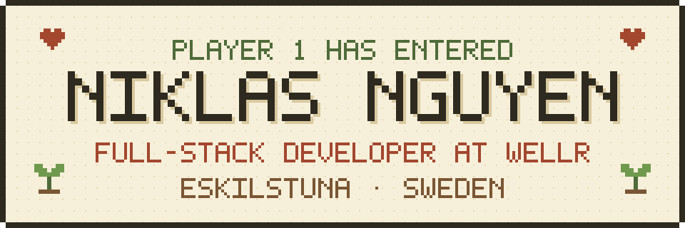

  

<table>
  <tr>
    <td width="240" valign="top">
      
    </td>
    <td valign="top">
      <h3>Hej! I'm Niklas.</h3>
      
I'm a full-stack developer at Wellr. I turn product ideas into working software: web, mobile and the backend behind them.

      

        <b>Class</b> &nbsp;Full-stack developer 
        <b>Guild</b> &nbsp;Wellr, since 2025 
        <b>Home</b> &nbsp;Eskilstuna, Sweden 
        <b>Languages</b> &nbsp;Svenska, English, Tiếng Việt
      

    </td>
  </tr>
</table>

## About

<table>
  <tr>
    <td width="50%" valign="top">
      <b>Today</b> 
      I like working close to the product, from the first problem to the finished feature, and making it better after it ships.
    </td>
    <td width="50%" valign="top">
      <b>Before code</b> 
      I was a CNC machinist at Volvo Group. It taught me quality and precision, and I still build software that way.
    </td>
  </tr>
</table>

## Current quest

**Full-stack developer at Wellr** · Feb 2025 – now

I take features from the first product need through UX, technical design, build, testing and release, across web, mobile and backend. Lately: statistics and insight features that help people understand their activity, mood and sleep.

## Quest log

| When | Where | What |
| --- | --- | --- |
| 2025 – now | **Wellr** | Full-stack developer · in progress |
| 2024 | **Tricom** | Full-stack developer, e-commerce |
| 2023 – 2024 | **Gastrogate** | Frontend developer intern |
| 2022 – 2024 | **KYH** | Frontend development studies |
| 2021 – 2022 | **Volvo Group, Gnutti Carlo** | CNC machinist |

## Inventory

| Frontend | Backend | Data | Design |
| --- | --- | --- | --- |
| React, TypeScript, React Native | C#, .NET, ASP.NET Core, EF Core | SQL, MongoDB, PostgreSQL, GraphQL | UX/UI, Figma |

## Let's talk

Questions, ideas or just want to say hej? My inbox is open.

[niklas.van.nguyen@gmail.com](mailto:niklas.van.nguyen@gmail.com) · [LinkedIn](https://www.linkedin.com/in/niklas-nguyen)

Thanks for visiting · Game saved
